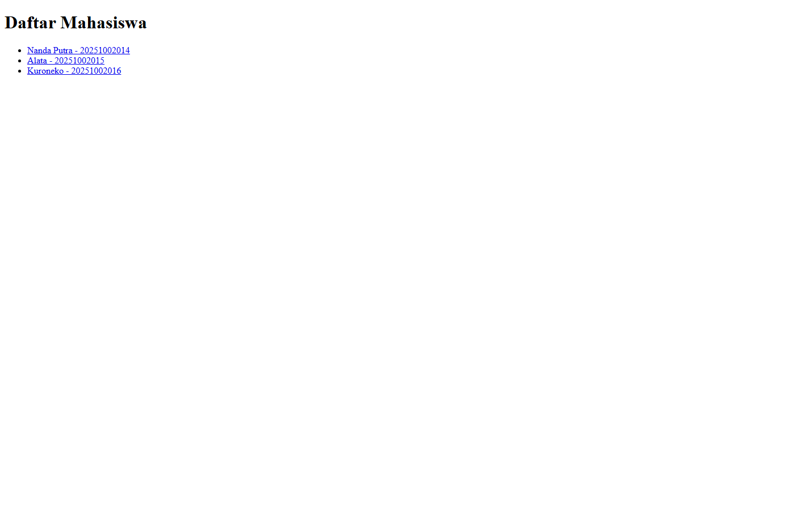
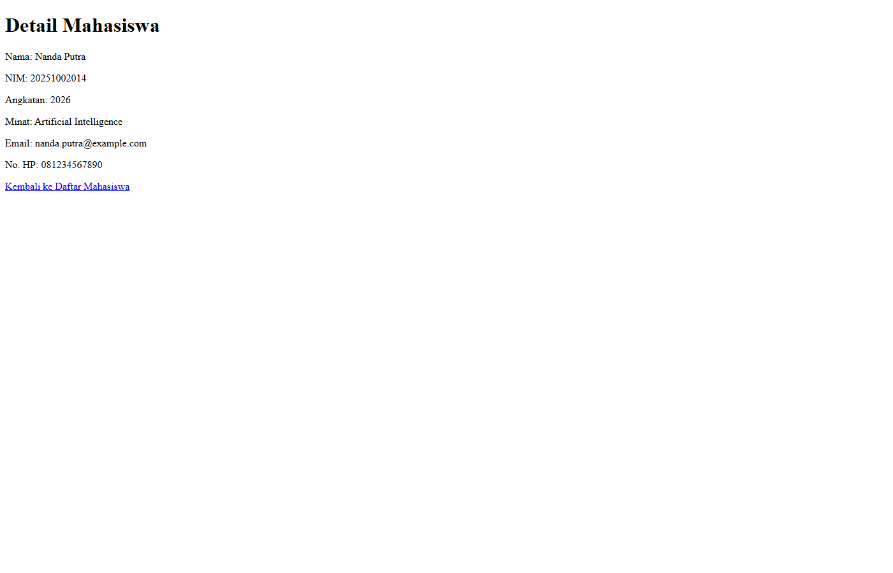
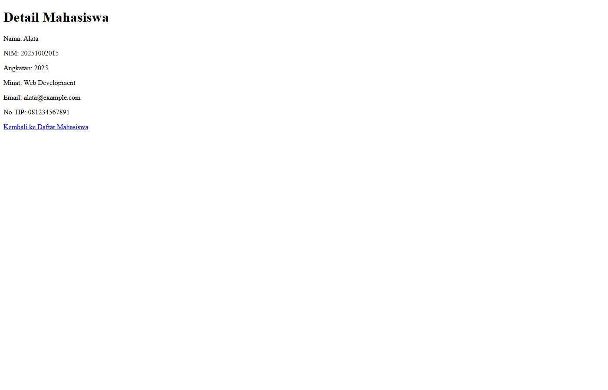

# Aplikasi Data Mahasiswa

Aplikasi Laravel sederhana dengan studi kasus data mahasiswa. Project ini dibuat untuk memenuhi tugas Pertemuan 7 PBO tentang alur **Route -> Controller -> Blade**.

## Pemeriksaan kriteria tugas

| Kriteria | Status | Implementasi |
| --- | --- | --- |
| Tambahkan satu halaman | Terpenuhi | Tersedia halaman daftar `/mahasiswa` dan halaman detail `/mahasiswa/{id}`. |
| Minimal satu route dengan parameter | Terpenuhi | Route `mahasiswa.show` menggunakan parameter `{id}`. |
| Controller menyiapkan data | Terpenuhi | `MahasiswaController` menyediakan data contoh melalui method `mahasiswaData()`. |
| Blade `@if` | Terpenuhi | Digunakan untuk memeriksa data kosong dan detail yang tidak ditemukan. |
| Blade `@foreach` | Terpenuhi | Digunakan untuk menampilkan daftar mahasiswa. |
| README singkat dan dokumentasi | Terpenuhi | README ini menjelaskan alur, file, dan cara menjalankan aplikasi. |
| Screenshot hasil | Terpenuhi | Screenshot halaman daftar dan detail disertakan pada bagian dokumentasi. |

## Fitur aplikasi

Aplikasi memiliki dua halaman utama:

1. **Daftar mahasiswa** pada `/mahasiswa`.
2. **Detail mahasiswa** pada `/mahasiswa/{id}`.

Data yang ditampilkan terdiri dari nama, NIM, angkatan, minat, email, dan nomor HP. Data masih berupa array di dalam Controller karena tugas belum membutuhkan database.

## Penjelasan kode

### 1. Route - `routes/web.php`

```php
Route::get('/mahasiswa', [MahasiswaController::class, 'index'])
    ->name('mahasiswa.index');

Route::get('/mahasiswa/{id}', [MahasiswaController::class, 'show'])
    ->whereNumber('id')
    ->name('mahasiswa.show');
```

Route pertama mengarahkan URL `/mahasiswa` ke method `index()`. Route kedua menerima parameter `id`, misalnya `/mahasiswa/1`, lalu mengarahkan request ke method `show()`.

`whereNumber('id')` memastikan parameter ID hanya berupa angka. Kedua route memiliki nama agar URL dapat dibuat menggunakan helper `route()` tanpa menulis alamat secara manual.

### 2. Controller - `app/Http/Controllers/MahasiswaController.php`

Method `index()` mengambil data mahasiswa dari `mahasiswaData()` dan mengirimkannya ke view `mahasiswa.index`.

Method `show(string $id)` menerima parameter dari URL, mencari data mahasiswa berdasarkan ID, kemudian mengirim data tersebut ke view `mahasiswa.show`. Jika ID tidak ditemukan, nilai mahasiswa menjadi `null` agar Blade dapat menampilkan pesan yang sesuai.

Method `mahasiswaData()` berisi data contoh mahasiswa dalam bentuk array. Pemisahan data ini membuat daftar dan detail menggunakan sumber data yang sama sehingga tidak terjadi perbedaan isi antara kedua halaman.

### 3. Blade daftar - `resources/views/mahasiswa/index.blade.php`

View daftar menggunakan:

- `@if` untuk menampilkan pesan ketika data mahasiswa kosong.
- `@foreach` untuk mengulang seluruh data mahasiswa.
- `route('mahasiswa.show', ['id' => ...])` untuk membuat link menuju halaman detail.
- `{{ }}` untuk menampilkan data dengan output yang di-escape oleh Blade.

Alur halaman daftar:

```text
GET /mahasiswa
    -> mahasiswa.index
    -> MahasiswaController@index
    -> mahasiswa/index.blade.php
```

### 4. Blade detail - `resources/views/mahasiswa/show.blade.php`

View detail menggunakan `@if ($mahasiswa !== null)` untuk membedakan dua kondisi:

- Data ditemukan: detail mahasiswa ditampilkan.
- Data tidak ditemukan: pesan ID tidak ditemukan ditampilkan.

View ini juga menyediakan link kembali ke route `mahasiswa.index`.

Alur halaman detail:

```text
GET /mahasiswa/1
    -> mahasiswa.show dengan parameter id = 1
    -> MahasiswaController@show
    -> mahasiswa/show.blade.php
```

## Struktur file

```text
app/Http/Controllers/MahasiswaController.php
resources/views/mahasiswa/index.blade.php
resources/views/mahasiswa/show.blade.php
routes/web.php
tests/Feature/MahasiswaTest.php
screenshots/mahasiswa.png
screenshots/mahasiswa-detail-1.png
screenshots/mahasiswa-detail-2.png
screenshots/mahasiswa-detail-3.png
```

## Screenshot hasil

### Halaman daftar mahasiswa - `/mahasiswa`



Halaman ini menampilkan tiga mahasiswa dan link menuju halaman detail masing-masing.

### Halaman detail mahasiswa - `/mahasiswa/1`



Halaman ini membuktikan bahwa parameter `id` berhasil diterima dan digunakan untuk menampilkan data Nanda Putra.

### Halaman detail mahasiswa - `/mahasiswa/2`



### Halaman detail mahasiswa - `/mahasiswa/3`


## Cara menjalankan project

Pastikan PHP 8.3 atau lebih baru, Composer, dan Node.js sudah terpasang.

```bash
composer install
copy .env.example .env
php artisan key:generate
npm install
npm run build
php artisan serve
```

Buka alamat berikut di browser:

- Daftar mahasiswa: `http://127.0.0.1:8000/mahasiswa`
- Detail mahasiswa: `http://127.0.0.1:8000/mahasiswa/1`

## Pengujian

Jalankan pengujian dengan perintah:

```bash
php artisan test --compact
```

Feature test memeriksa halaman daftar, link menuju detail, penggunaan parameter ID, dan kondisi ketika ID mahasiswa tidak ditemukan.
